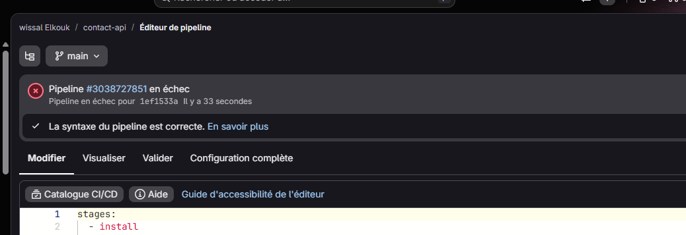
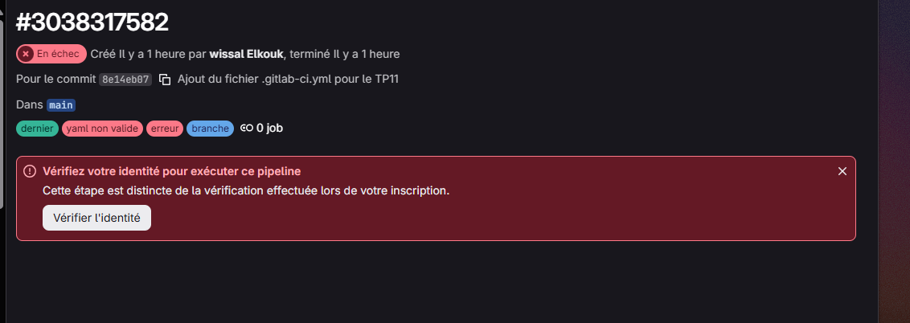
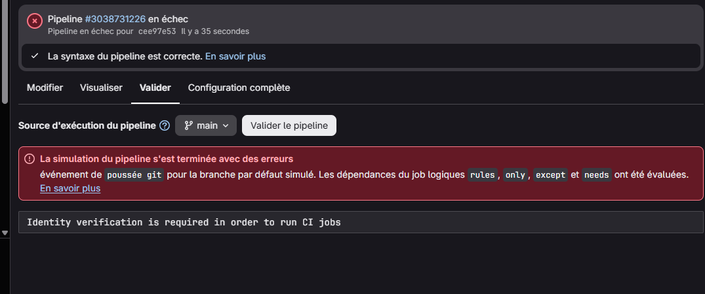
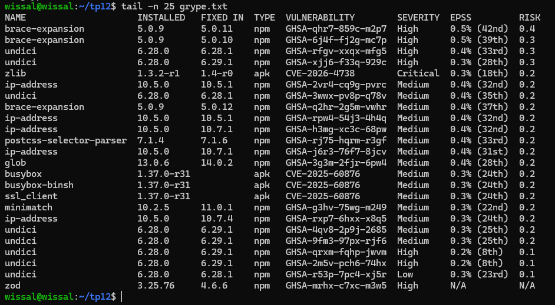
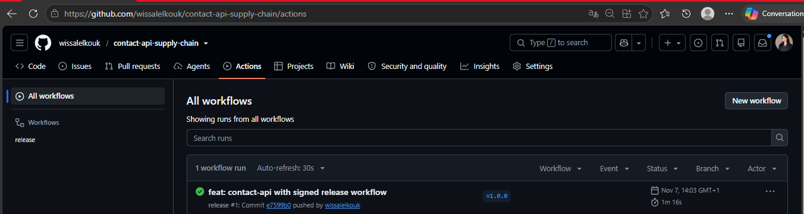
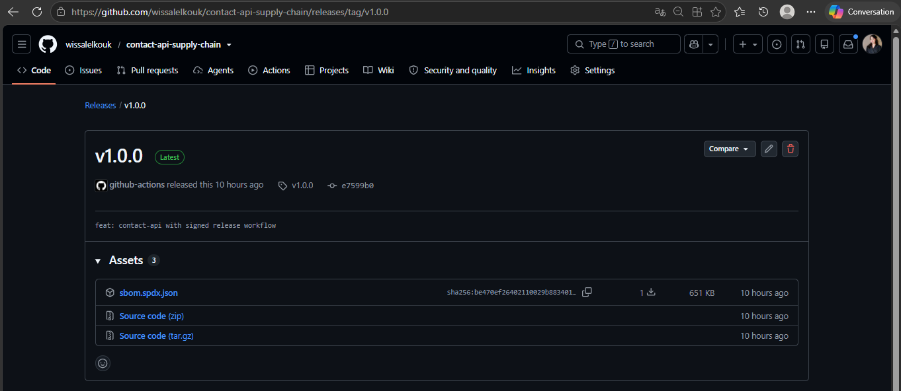
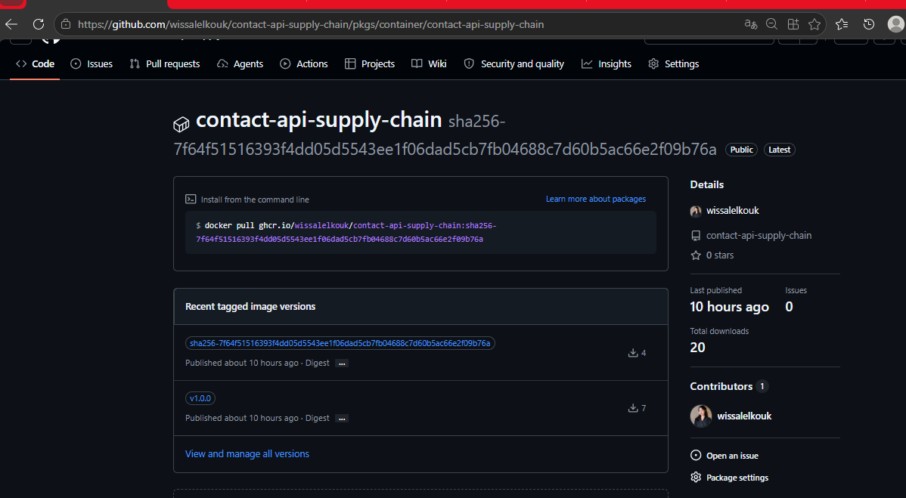
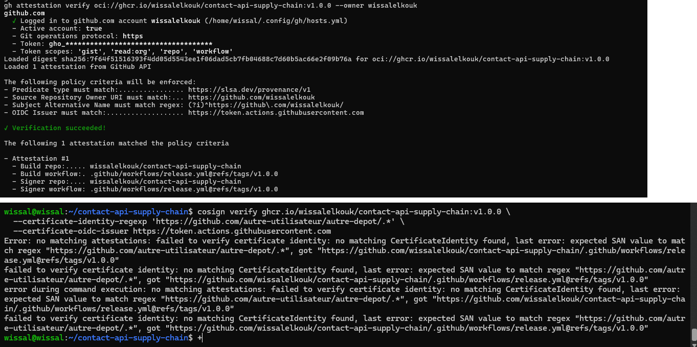
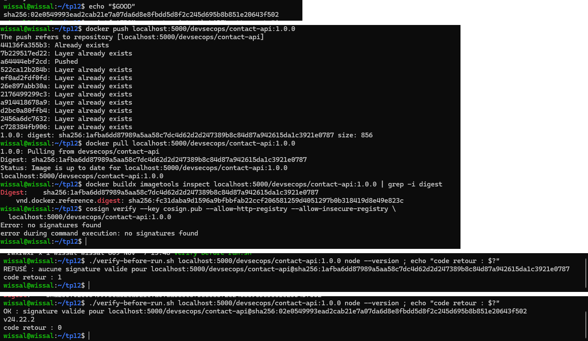

# TP9 : Pipeline as Code avec Jenkins

Pipeline Jenkins décrit dans le dépôt (`Jenkinsfile`) pour l'API Express `contact-api` du TP8 : stages, exécution parallèle, agent Docker, rapports JUnit, credentials, image Docker taguée avec le Git SHA, puis job Multibranch (branches et Pull Requests).

- **Dépôt** : `wissalelkouk/tp9-jenkins-pipeline` (code de l'API issu du TP8)
- **Dépôt utilisé par Jenkins pendant le TP** : `wissalelkouk/tp8-api-securisee` (les builds visibles sur les captures y ont été exécutés avant la copie du projet vers ce dépôt)
- **Image Docker Hub** : [`wissl/contact-api`](https://hub.docker.com/r/wissl/contact-api/tags)
- **Jenkins** : 2.580.1 (LTS), Docker sur la même VM (Ubuntu Server)
- **Jobs** : `contact-api` (Pipeline from SCM) et `contact-api-multibranch` (Multibranch)

---

## 1. Le pipeline

Le `Jenkinsfile` à la racine du dépôt définit les stages suivants :

| Stage | Rôle |
|---|---|
| Checkout | `checkout scm`, calcul de `SHORT_SHA = GIT_COMMIT.take(7)` |
| Install | `npm ci` dans un agent Docker `node:24-alpine` (`reuseNode true`) |
| Quality (parallèle) | **Lint** (`npm run lint`) et **Unit tests** (Vitest + rapport JUnit) |
| Build image | `docker build` avec le label `org.opencontainers.image.revision=${GIT_COMMIT}` et le tag `${IMAGE_NAME}:${SHORT_SHA}` |
| Push | `docker push`, **uniquement sur `main`**, avec le credential `dockerhub` |
| post | `junit` (always), `archiveArtifacts image.txt`, `cleanWs` (cleanup) |

Options : `disableConcurrentBuilds()`, `timestamps()`, `timeout(60 min)`, `buildDiscarder`.

Points importants :

- Le rapport JUnit est produit avec :
  `npm test -- --reporter=default --reporter=junit --outputFile.junit=reports/junit.xml`
  (le script `npm test` du projet exclut les tests d'intégration, qui exigent PostgreSQL).
- Le token Docker Hub est injecté avec `withCredentials` et utilisé via `--password-stdin`, dans des `sh` à **guillemets simples** : c'est le shell, pas Groovy, qui substitue les variables, donc le secret n'est jamais interpolé dans le script.
- La condition du stage Push couvre le job Multibranch (`branch 'main'`) et le job Pipeline simple (`GIT_BRANCH == 'origin/main'`).

---

## 2. Captures

### 2.1 Vue des stages : Lint et Unit tests en parallèle

Build #4 du job `contact-api` : tous les stages sont verts, **Lint** et **Unit tests** s'exécutent en parallèle dans *Quality*.


### 2.2 Rapport JUnit : un test en échec puis corrigé

Un test a été cassé volontairement (`GET /api/health`). Sur le build #5, **Unit tests** passe en rouge, **Build image** et **Push** sont sautés, le bloc `post` s'exécute et l'onglet *Tests* affiche le test en échec. Après correction (build #6), les 14 tests passent.


### 2.3 Credential masqué dans les logs

Le token Docker Hub apparaît sous la forme `****` dans la Console Output (`Masking supported pattern matches of $DH_TOKEN`), et le login réussit.


### 2.4 Image taguée avec le Git SHA

Le tag de l'image sur Docker Hub correspond au résultat de `git rev-parse --short HEAD` : ici `daada40` (build #6 du job `contact-api`). Sur `main`, le build final du Multibranch (#2, après le merge de la PR) a poussé le tag `827549a`, qui correspond aussi à `git rev-parse --short HEAD` sur `main`.


### 2.5 Multibranch Pipeline

Le job `contact-api-multibranch` découvre `main`, la branche `feature/rate-limit-config` et la Pull Request `PR-1`. Le stage **Push est sauté** sur la branche et sur la PR, et **exécuté sur `main`** après le merge (build #2, commit `827549a`, artefact `image.txt`).


---

## 3. Configuration Jenkins

**Plugins** : Pipeline, Git, GitHub Branch Source, Docker Pipeline, JUnit, Credentials Binding, Workspace Cleanup, Timestamper.

**Accès Docker** : `sudo usermod -aG docker jenkins && sudo systemctl restart jenkins`

**Credentials** :

| ID | Type | Usage |
|---|---|---|
| `dockerhub` | Username with password (access token Docker Hub) | Push de l'image |
| `github` | Username with password (fine-grained token, lecture seule) | Scan du dépôt par le Multibranch |

**Job Multibranch** : source GitHub, scan périodique toutes les 2 minutes (« Periodically if not otherwise run »), car la VM n'est pas joignable depuis Internet et ne peut pas recevoir de webhook. La stratégie *Discover branches* est réglée sur **All branches** pour afficher la branche en même temps que sa PR.

---

## 4. Problèmes rencontrés et solutions

| Problème | Cause | Solution |
|---|---|---|
| Jenkins ne démarrait pas (`start operation timed out`) | Démarrage lent sur une petite VM, timeout systemd par défaut | `TimeoutStartSec=600` dans un override systemd |
| Contrôleur « déconnecté », builds en attente | `/tmp` (tmpfs) sous le seuil de 1 Go : accumulation de fichiers `winstone*.jar` | Nettoyage de `/tmp`, `java.io.tmpdir` déplacé vers `/var/lib/jenkins/tmp` |
| Pipeline `ABORTED` pendant le push | `timeout(20 min)` dépassé | Timeout porté à 60 minutes |
| `docker push` coupé (`use of closed network connection`, timeout) | Perte de paquets sur le réseau de la VM (environ 15 %) et couche d'environ 57 Mo | Nouvel essai quand la perte est revenue à 0 % : toutes les couches ont été envoyées, puis le stage Push du pipeline est passé |
| Branche barrée dans le Multibranch | Comportement par défaut : exclure les branches déjà couvertes par une PR | *Discover branches → All branches* |

---

## 5. Commandes utiles

```bash
# Tests et lint en local
npm ci
npm run lint
npm test

# Rapport JUnit comme dans le pipeline
npm test -- --reporter=default --reporter=junit --outputFile.junit=reports/junit.xml

# Build et vérification du label de l'image
SHORT_SHA=$(git rev-parse --short=7 HEAD)
docker build --label org.opencontainers.image.revision="$(git rev-parse HEAD)" \
  -t wissl/contact-api:$SHORT_SHA .
docker inspect wissl/contact-api:$SHORT_SHA \
  --format '{{ index .Config.Labels "org.opencontainers.image.revision" }}'

# Comparer avec le tag affiché sur Docker Hub
git rev-parse --short HEAD
```

---

## 6. Livrables

| Fichier | Contenu |
|---|---|
| `Jenkinsfile` | Pipeline final |
| `captures/pipeline-stages.png` | Lint et Unit tests en parallèle |
| `captures/junit-report.png` | Test en échec puis corrigé |
| `captures/credentials-masked.png` | Token masqué (`****`) |
| `captures/dockerhub-sha-tag.png` | Tag `<sha>` sur Docker Hub et `git rev-parse --short HEAD` |
| `captures/multibranch.png` | Jobs `main`, `feature/…` et `PR-1` |

Le défi (Shared Library `buildAndPush` et plugin GitHub Checks) n'a pas été réalisé.

* * *

# TP10 : DevSecOps « Shift Left »

Analyse de l'application volontairement vulnérable `vuln-app` avec des outils open source (secrets, SAST, dépendances, images, configuration), branchés dans GitHub Actions et Jenkins avec des quality gates, puis correction des failles.

- **Dépôt TP10** : [`wissalelkouk/vuln-app`](https://github.com/wissalelkouk/vuln-app) (code corrigé, `security.yml`, `dependabot.yml`, `Jenkinsfile`)
- **Outils** : Gitleaks, pre-commit, Semgrep, npm audit, Trivy, Dependabot, CodeQL, GitHub Actions, Jenkins
- **Le Jenkinsfile du TP9 n'étant pas dans `vuln-app`**, un Jenkinsfile dédié a été créé pour le TP10 (job `vuln-app`, branche `ci/jenkins`).

## 1. Carte des scanners

| Famille | Question posée | Outils utilisés |
|---------|----------------|-----------------|
| Secrets | Un mot de passe ou un token est-il dans Git ? | Gitleaks, push protection GitHub |
| SAST | Mon code contient-il des motifs dangereux ? | Semgrep, CodeQL |
| SCA | Mes dépendances ont-elles des CVE connues ? | npm audit, Trivy fs, Dependabot |
| Image | Les paquets de l'image ont-ils des CVE ? | Trivy image |
| Config | Le Dockerfile est-il mal configuré ? | Trivy config |

## 2. Partie 1 : Secrets (Gitleaks)

Gitleaks a détecté **1 secret sur 3** : règle `generic-api-key`, `src/config.js` ligne 5 (`jwt_secret`), commit `8b0c839`. `payment_api_key` et `db_password` n'ont pas été détectés : un scanner ne voit pas tout, les trois valeurs ont donc été retirées.

Les secrets sont passés dans des variables d'environnement (`process.env`), avec `.env.example` versionné et `.env` ignoré. Gitleaks détecte toujours le secret **dans l'historique** : supprimer la ligne ne suffit jamais. Pour un vrai secret : le **révoquer** (il est compromis), puis éventuellement réécrire l'historique (`git filter-repo`). Pour le lab, l'historique a été recréé, et Gitleaks répond `no leaks found`.

[](captures/tp10-gitleaks.png)

## 3. Partie 2 : Hook pre-commit

Le hook Gitleaks refuse un commit contenant `const token = "…"` (`generic-api-key`, `src/test-secret.js:1`, exit code 1).

[](captures/tp10-pre-commit-blocked.png)

## 4. Partie 3 : SAST (Semgrep)

Premier scan : **7 résultats bloquants**. Après correction : **0 résultat, code retour 0**.

| Règle | Fichier:ligne | Vrai positif ? | Correction |
|-------|---------------|----------------|------------|
| `raw-html-format` | `server.js:32` | Oui | `res.json` |
| `direct-response-write` | `server.js:32` | Oui (même faille) | `res.json` |
| `missing-user` | `Dockerfile:8` | Oui | `USER node` |
| `github-actions-mutable-action-tag` (×4) | `security.yml:18, 26, 33, 40` | Oui | Actions épinglées par SHA complet |
| *(non détecté)* injection SQL | `server.js:21` | Oui | requête paramétrée `?` |
| *(non détecté)* injection de commande | `server.js:27` | Oui | `execFile` + validation de `host` |
| *(non détecté)* JWT sans expiration | `server.js:43` | Oui | `expiresIn: "1h"` |

Semgrep n'a pas signalé l'injection SQL, l'injection de commande ni le JWT : ces failles ont été corrigées à la main, ce qui montre l'intérêt de combiner plusieurs outils.

[](captures/tp10-semgrep-before-after.png)

## 5. Partie 4 : Dépendances, images et configuration

| Contrôle | Avant | Après |
|----------|-------|-------|
| `npm audit` | 16 (1 critical, 10 high, 5 low) | **0** |
| Trivy fs (dépendances) | nombreuses CVE HIGH/CRITICAL (`tar`…) | **0** |
| Trivy config | `DS-0031` **CRITICAL** (`ENV DB_PASSWORD=…`) | `DS-0026` LOW, corrigé par un `HEALTHCHECK` |
| Trivy image (GitHub Actions) | Debian 10 : 16 + 2 CRITICAL | Alpine 3.24 (`node:24-alpine`) : plus de CRITICAL corrigeable |

Mises à jour : `express`, `jsonwebtoken` 9, `lodash` 4.18, `sqlite3` 6. Dockerfile réécrit : `node:24-alpine`, multi-stage, `USER node`, aucun secret dans `ENV`.

Job `image` de GitHub Actions après correction (Alpine, tous les paquets à 0, job vert) :

[](captures/tp10-trivy-after.png)

**Dependency-Check** : la mise à jour de la base NVD a échoué (clé d'API refusée). Il a été remplacé par **Trivy fs**.

**Trivy image** : la base n'a pas pu être téléchargée de façon fiable depuis la VM (réseau très lent). Les scans d'image ont été exécutés dans GitHub Actions et Jenkins, la base ayant ensuite été mise en cache localement pour `fs` et `config`.

## 6. Partie 5 : GitHub

**Dependabot** : PR ouvertes automatiquement (`express` 4.22.3 → 5.3.0, `upload-sarif`). Le passage à Express 5 est un changement majeur : la PR n'a pas été fusionnée.

[](captures/tp10-dependabot-pr.png)

**CodeQL vs Semgrep** (PR #3 qui réintroduit les failles) :

| Faille | Semgrep | CodeQL |
|--------|---------|--------|
| Injection SQL | Non détectée | Non détectée |
| Injection de commande | Non détectée | Non détectée |
| XSS | Oui (2 règles) | Oui (High) |
| Rate limiting | Non | Oui (High, sur `main`) |
| Permissions du workflow | Non | Oui (Medium, sur `main`) |

[](captures/tp10-codeql-alerts.png)

**Workflow `security.yml`** : `permissions: contents: read` au niveau du workflow, `security-events: write` uniquement dans le job `sast` (export SARIF), Gitleaks, Semgrep, `npm audit` et Trivy en conteneurs, Actions tierces épinglées par SHA.

Pourquoi épingler par SHA ? Un tag (`v4`) peut être déplacé vers du code malveillant si le dépôt de l'Action est compromis. Un SHA de commit est immuable, et Dependabot (`github-actions`) propose ensuite les mises à jour.

**Ruleset `protect-main`** : PR obligatoire, 1 approbation, checks `secrets`, `sast`, `dependencies`, `image` obligatoires, force push bloqué. La PR #3 (faille réintroduite) est bloquée : `sast` et CodeQL sont en échec, `image` est ignoré.

[](captures/tp10-pr-blocked.png)

La PR #4 (correctif) passe tous les checks mais reste bloquée tant qu'un relecteur n'approuve pas. Seul développeur, j'ai ajouté un bypass temporaire pour la fusionner, puis je l'ai retiré.

[](captures/tp10-pr4-review-required.png)

## 7. Partie 6 : Quality gates dans Jenkins

Le `Jenkinsfile` exécute `Checkout`, `Build`, puis un stage **Security** avec Gitleaks, Semgrep et `npm audit` **en parallèle**, puis **Image scan** (Trivy `--exit-code 1 --severity CRITICAL`). Les rapports sont archivés (`archiveArtifacts 'reports/**'`).

- **Build #3 : rouge.** Semgrep a détecté la faille (XSS), `Image scan` est ignoré et aucun rapport Trivy n'est produit.
- **Build #4 : vert.** `server.js` corrigé, image scannée sur Alpine, 4 rapports archivés.

[](captures/tp10-jenkins-stages.png)

| Build #3 (rouge) | Build #4 (vert) |
|------------------|-----------------|
| [](captures/tp10-jenkins-build3-artifacts.png) | [](captures/tp10-jenkins-build4-artifacts.png) |

## 8. Défi

- **Règle Semgrep personnalisée** (`.semgrep/no-log-body.yml`) interdisant `console.log(req.body)`, ajoutée à `security.yml` et au `Jenkinsfile`. Test : `Findings: 1 (1 blocking)`.
- **`.trivyignore`** avec une date d'expiration (`exp:`). L'identifiant est fictif (aucune CVE à ignorer sur l'image finale) : il illustre le format.
- **Ignorer ou accepter un risque ?** *Ignorer* masque un résultat sans laisser de trace. *Accepter un risque* est une décision documentée : justification, responsable, date d'expiration et revue périodique. À l'échéance, le résultat réapparaît.

## 9. Problèmes rencontrés

| Problème | Cause | Solution |
|----------|-------|----------|
| `push` refusé (`workflow` scope) | Token sans le droit `workflow` | Nouveau token avec `repo` et `workflow` |
| Hook refusé (`configuration is unstaged`) | `pre-commit autoupdate` avait modifié la config | `git add .pre-commit-config.yaml` |
| Dependency-Check en échec | Clé d'API NVD refusée | Remplacé par Trivy fs |
| Trivy : `context deadline exceeded` | Réseau lent vers les registres de la base | Scans dans GitHub Actions et Jenkins, base mise en cache |
| `server.js` cassé (doublon `rateLimit`) | Corrections par `sed` appliquées deux fois | Fichier réécrit proprement, fusionné via PR |

## 10. Livrables TP10

| Fichier | Contenu |
|---------|---------|
| `captures/tp10-gitleaks.png` | Secret détecté par Gitleaks |
| `captures/tp10-pre-commit-blocked.png` | Commit refusé par le hook |
| `captures/tp10-semgrep-before-after.png` | Semgrep : 7 résultats puis 0 |
| `captures/tp10-trivy-after.png` | Trivy image (Actions) : image Alpine propre |
| `captures/tp10-dependabot-pr.png` | PR Dependabot |
| `captures/tp10-codeql-alerts.png` | Alertes CodeQL et Semgrep sur la PR #3 |
| `captures/tp10-pr-blocked.png` | PR bloquée par les checks obligatoires |
| `captures/tp10-pr4-review-required.png` | PR #4 : checks verts, relecture requise |
| `captures/tp10-jenkins-stages.png` | Pipeline Jenkins rouge (#3) puis vert (#4) |
| `captures/tp10-jenkins-build3-artifacts.png`, `…build4-artifacts.png` | Rapports archivés |

Code corrigé, `.github/workflows/security.yml`, `.github/dependabot.yml`, `Jenkinsfile` : voir [`wissalelkouk/vuln-app`](https://github.com/wissalelkouk/vuln-app).


* * *

# TP11 : GitLab CI/CD et runner auto-hébergé

Découverte du troisième grand outil de CI/CD après Jenkins (TP9) et GitHub Actions (TP3, TP10) : GitLab CI/CD, avec un runner auto-hébergé (executor Docker) installé sur la VM de lab.

- **Projet GitLab** : [`wissalelkouk/contact-api`](https://gitlab.com/wissalelkouk/contact-api)
- **Runner** : `lab-runner`, executor Docker, tag `lab`, image par défaut `node:24-alpine`
- **Limite rencontrée** : GitLab.com exige une vérification d'identité (carte bancaire) avant d'exécuter un pipeline, même sur un runner auto-hébergé. La carte a été refusée par la banque, donc **aucun pipeline n'a pu s'exécuter**. Les parties qui demandent une exécution (cache, registre, rapports de sécurité) n'ont pas de capture.

## 1. Partie 1 : Runner auto-hébergé

GitLab Runner est installé depuis le dépôt officiel et enregistré avec un jeton `glrt-…` (jamais publié), executor Docker, tag `lab`. La commande `sudo gitlab-runner verify` répond `Verifying runner... is valid`.

**Pourquoi aucun port ouvert sur la VM ?** Le runner fonctionne en mode *pull* : c'est lui qui interroge GitLab en HTTPS sortant pour récupérer les jobs. GitLab n'a jamais besoin de joindre la VM.

**Risque du montage du socket Docker.** Le TP demande d'ajouter `/var/run/docker.sock` aux `volumes` du runner (`/etc/gitlab-runner/config.toml`). Un job qui accède à ce socket contrôle le démon Docker de l'hôte : il peut lancer un conteneur privilégié, lire le disque de la VM ou compromettre les autres conteneurs, ce qui équivaut presque à un accès root. C'est le principe que le défi du TP supprime (build sans privilège avec Kaniko ou Buildah).

## 2. Partie 2 : Premier pipeline

Le `.gitlab-ci.yml` est poussé sur `main` et validé par GitLab (« La syntaxe du pipeline est correcte »). Il définit cinq stages (`install`, `test`, `security`, `build`, `push`), des dépendances `needs`, et utilise le tag `lab` pour cibler le runner.

[](captures/tp11-syntax-correct.png)

Une première erreur de configuration (`jobs:demo-variable:script config should be a string…`) venait d'un `echo "longueur: …"` : le `: ` dans le texte est lu comme une clé YAML. Corrigé en mettant la commande entre apostrophes. Le test Python `yaml.safe_load` ne l'avait pas vu, car il ne connaît pas le schéma de GitLab : la validation dans l'éditeur de pipeline est indispensable.

## 3. Blocage : vérification d'identité

Le pipeline ne démarre pas (0 job). GitLab affiche « Vérifiez votre identité pour exécuter ce pipeline », puis, dans l'onglet **Valider** : `Identity verification is required in order to run CI jobs`, alors que la syntaxe est correcte.

[](captures/tp11-identity-required-pipeline.png)

[](captures/tp11-identity-required-validate.png)

L'étiquette « yaml non valide » est trompeuse : c'est le libellé affiché pour un pipeline refusé avant de démarrer. La vérification par carte a été refusée par la banque (`card_declined`), ce qui a empêché toute exécution.

## 4. Partie 3 : Cache, artefacts, rules, registre (configuré, non exécuté)

Le `.gitlab-ci.yml` final contient :

- `cache` de `.npm/` avec `key: files: [package-lock.json]` ;
- `artifacts` : `node_modules/` (1 h) et rapport JUnit (`reports: junit:`, `when: always`) ;
- `rules` : `build-image` sur les merge requests et la branche par défaut, `push-image` uniquement sur la branche par défaut ;
- `docker login` avec `CI_REGISTRY_USER` et `CI_REGISTRY_PASSWORD` (`--password-stdin`), puis `docker push` de `$CI_REGISTRY_IMAGE:$CI_COMMIT_SHORT_SHA` ;
- `interruptible: true` pour annuler un pipeline obsolète ;
- un job `demo-variable` affichant la longueur de `DEMO_TOKEN`, variable masquée et protégée (absente des branches non protégées).

## 5. Partie 4 : Sécurité intégrée

Templates GitLab `Jobs/SAST.gitlab-ci.yml` et `Jobs/Secret-Detection.gitlab-ci.yml` ajoutés via `include`. GitLab SAST s'appuie sur **Semgrep** et Secret Detection sur un analyseur basé sur **Gitleaks** : ce sont les moteurs du TP10. Dans l'offre gratuite, les résultats sont des artefacts JSON ; le tableau de bord et le widget de merge request demandent Ultimate, d'où `npm audit` pour les dépendances (sans `allow_failure` : une vulnérabilité `high` doit bloquer).

Réglages à faire : branche `main` protégée (pas de push direct) et *Pipelines must succeed* avant fusion.

## 6. Partie 5 : Comparaison Jenkins, GitHub Actions, GitLab CI/CD

| Critère | Jenkins | GitHub Actions | GitLab CI/CD |
|---------|---------|----------------|--------------|
| Configuration | `Jenkinsfile` (Groovy), plugins | YAML dans `.github/workflows/`, actions du Marketplace | `.gitlab-ci.yml`, `include`, `needs`, `rules` |
| Runners / agents | Serveur et agents à gérer | Runners hébergés ou auto-hébergés | Runners partagés ou auto-hébergés, modèle *pull* |
| Secrets | Credentials Jenkins | Secrets de dépôt ou d'environnement | Variables CI/CD masquées et protégées |
| Sécurité intégrée | Aucune, outils externes en conteneurs | Dependabot, CodeQL, secret scanning, push protection | Templates SAST et Secret Detection, le reste en Ultimate |
| Maintenance | Lourde (Jenkins, plugins, sauvegardes) | Faible, gérée par GitHub | Faible sur GitLab.com, runner à maintenir |
| Intégration Git | Plugins et webhooks | Native à GitHub | Native : forge, CI et registre intégrés |

**Recommandation pour une PME.** Une PME qui démarre devrait choisir **GitHub Actions** si son code est déjà sur GitHub, ou **GitLab CI/CD** pour une plateforme unique (forge, CI, registre). Les deux évitent d'exploiter un serveur, alors que Jenkins demande du temps d'administration (mises à jour, plugins, sauvegardes) qu'une petite équipe n'a pas. GitHub Actions est le plus rapide à prendre en main, avec Dependabot, CodeQL et la protection des secrets intégrés. GitLab CI/CD offre un pipeline mieux structuré et un registre de conteneurs inclus, mais certaines fonctions de sécurité sont payantes. Jenkins reste pertinent pour des besoins très spécifiques ou une infrastructure existante. Dans tous les cas, il faut appliquer le moindre privilège (secrets masqués, branches protégées, runners isolés, pas de `docker.sock`) et mettre les scanners (Gitleaks, Semgrep, Trivy, `npm audit`) dans la CI avec des quality gates dès le départ. Enfin, l'accès compte : sur GitLab.com, la vérification d'identité par carte a bloqué mon pipeline, alors que GitHub Actions n'en a pas demandé.

## 7. Défi (non réalisé)

Remplacer le montage du socket Docker par Kaniko (ou Buildah, BuildKit rootless) et retirer `/var/run/docker.sock` du `config.toml`. Le déploiement d'un runner dans Kubernetes (chart Helm `gitlab/gitlab-runner`) est prévu après le TP14.

## 8. Problèmes rencontrés

| Problème | Cause | Solution |
|----------|-------|----------|
| `git push` refusé (Authentication failed) | Mot de passe utilisé à la place d'un token | Personal Access Token avec `write_repository` |
| Pipeline « yaml non valide », 0 job | Vérification d'identité GitLab non faite | Vérification par carte (refusée par la banque) |
| `script config should be a string` | `: ` dans un `echo` lu comme clé YAML | Commande entre apostrophes |
| `push` rejeté (`fetch first`) | Enregistrement depuis l'éditeur de pipeline GitLab | `git pull --no-rebase -X ours`, puis push ; l'éditeur ne sert qu'à valider |

## 9. Livrables TP11

| Fichier | Contenu |
|---------|---------|
| `captures/tp11-syntax-correct.png` | Syntaxe du pipeline validée par GitLab |
| `captures/tp11-identity-required-pipeline.png` | Pipeline bloqué : vérification d'identité |
| `captures/tp11-identity-required-validate.png` | `Identity verification is required in order to run CI jobs` |
| `.gitlab-ci.yml` | Pipeline final (dans `contact-api`) |

Captures non réalisées faute d'exécution : `runner-online`, `pipeline-graph`, `cache`, `mr-pipeline`, `container-registry`, `security-reports`.

* * *

# TP12 : Software Supply Chain (SBOM, Cosign, provenance, SLSA)

Mise en place des briques qui permettent de savoir ce que contient une image (SBOM), de prouver qui l'a construite et comment (signature, provenance) et de refuser ce qui n'est pas prouvé.

- **Dépôt de la partie keyless** : [`wissalelkouk/contact-api-supply-chain`](https://github.com/wissalelkouk/contact-api-supply-chain) (workflow `release.yml`, images dans GHCR)
- **Registre du lab** : `registry:2` sur `localhost:5000` (voir la limite ci-dessous)
- **Outils** : Syft, Grype, Trivy, Cosign v3, GitHub Actions, GitHub CLI

## 1. Partie 1 et 2 : Harbor (non réalisé)

Harbor n'a **pas été installé** : la VM de lab dispose de 3,5 Go de RAM (1,3 Go disponibles, swap déjà utilisé), 15 Go de disque libres et son port 80 est occupé par un autre conteneur, alors que Harbor demande 4 Go de RAM, 40 Go de disque et le port 80. Il a été remplacé par un registre `registry:2`, qui suffit pour les parties 3 à 6. Le RBAC, les robot accounts, le scan Trivy intégré avec blocage des pulls et la rétention de tags **n'ont donc pas été testés**.

| Critère | GHCR | Harbor |
|---------|------|--------|
| Hébergement | Géré par GitHub | Auto-hébergé (VM, Kubernetes) |
| RBAC | Droits GitHub (organisation, dépôt) | Projets, rôles, robot accounts |
| Scan | Via GitHub (Dependabot, actions) | Trivy intégré, pull bloqué selon la gravité |
| Réplication | Non | Oui, vers d'autres registres |
| Coût | Gratuit pour le public, quota pour le privé | Gratuit, mais coût d'exploitation |
| Usage hors ligne | Non | Oui (réseau isolé) |

## 2. Partie 3 : SBOM (Syft) et analyse (Grype)

Syft a généré le SBOM de `contact-api:test` en SPDX et CycloneDX.

| Question | Réponse |
|----------|---------|
| Nombre de paquets | **250** |
| Version d'`express` | **5.3.0** |
| Version d'OpenSSL | `libssl3` **3.5.9-r0** (Alpine ne le nomme pas `openssl`) |

Grype analyse le **SBOM** (et non l'image) : 24 vulnérabilités, dont 1 critique (`zlib 1.3.2-r1`, `CVE-2026-4738`, corrigé en `1.4-r0`), 7 High, 15 Medium et 1 Low. La base de Grype n'a pu être téléchargée qu'au second essai, avec un volume de cache et un délai plus long (connexion de la VM instable).

Intérêt : conserver le SBOM de chaque release permet de répondre en quelques secondes à « suis-je concerné par la CVE X ? » sans reconstruire ni retélécharger les images.

[](captures/tp12-sbom-grype.png)

## 3. Partie 4 : Signer et vérifier avec Cosign (clés)

Paire de clés générée avec `cosign generate-key-pair` (`cosign.key` chiffrée, jamais versionnée). L'image `1.0.0` est signée **par digest** (`sha256:02e05499…`) ; `1.0.1` est une image différente, volontairement non signée.

| Test | Résultat |
|------|----------|
| `cosign verify` sur `1.0.0` | Réussi (claims validés, signature vérifiée avec `cosign.pub`) |
| `cosign verify` sur `1.0.1` | `Error: no signatures found` |
| `cosign attest` du SBOM (SPDX) puis `verify-attestation` | Réussi : statement in-toto (`in-toto.io/Statement/v0.1`) dont le prédicat est le SBOM |

Une signature est liée au **digest**, pas au tag : si `1.0.1` avait eu le même contenu que `1.0.0`, elle aurait été acceptée aussi.

## 4. Partie 5 : Keyless et provenance (GitHub Actions)

Le workflow `release.yml`, déclenché par le tag `v1.0.0`, construit et pousse l'image dans GHCR, la signe en **keyless** (jeton OIDC, certificat éphémère Fulcio, journal public Rekor), génère le SBOM (`anchore/sbom-action`), produit une attestation de provenance (`actions/attest-build-provenance`) et joint le SBOM à la release. Actions tierces épinglées par SHA, permissions minimales (`contents: read` par défaut, droits supplémentaires limités au job).

[](captures/tp12-actions-release.png)

[](captures/tp12-release-sbom.png)

[](captures/tp12-ghcr-package.png)

Vérification depuis la VM : `cosign verify` keyless réussit (signature et provenance SLSA v1 présentes, certificat validé) et `gh attestation verify` répond « Verification succeeded » (build et signer : `release.yml@refs/tags/v1.0.0`). Avec une **mauvaise identité** (`autre-utilisateur/autre-depot`), la vérification échoue : le certificat contient l'identité du workflow réel.

[](captures/tp12-keyless-provenance.png)

**Pourquoi l'identité attendue est essentielle ?** La signature seule prouve qu'**un** workflow a signé. Sans identité imposée, le workflow de n'importe quel autre dépôt pourrait signer et être accepté. L'identité prouve que c'est **le bon**.

## 5. Partie 6 : Attaque simulée et vérification avant exécution

Un « attaquant » pousse une image modifiée sous le tag `1.0.0` : le tag pointe désormais vers un autre digest (`1afba6dd…` au lieu de `02e05499…`). `docker pull` ne signale rien, alors que `cosign verify` échoue (`no signatures found`).

Le script `verify-before-run.sh` résout le tag en digest, vérifie la signature sur ce digest, puis lance **ce même digest** : un attaquant ne peut pas changer le tag entre la vérification et l'exécution. Sur l'image remplacée : `REFUSÉ`, code retour 1, aucun conteneur lancé. Sur l'image légitime : `OK : signature valide`, le conteneur démarre, code retour 0.

[](captures/tp12-attack-detected.png)

Limites du script : il fait confiance à la clé locale `cosign.pub`, et il protège seulement ce poste. Une protection de plateforme (admission controller Kubernetes) vérifie la signature avant tout déploiement. `registry:2` accepte d'écraser un tag ; avec Harbor, les tags immuables (`v*`) l'auraient refusé.

## 6. SLSA et in-toto

| Niveau | Exigence principale | Atteint par |
|--------|---------------------|-------------|
| Build L1 | Provenance existante | Pipeline Jenkins si on génère une provenance ; build sur le poste : non |
| Build L2 | Provenance signée, générée par une plateforme hébergée | Workflow GitHub Actions avec `actions/attest-build-provenance` |
| Build L3 | Plateforme durcie, provenance infalsifiable par le projet | Non atteint ici (il faudrait un workflow réutilisable isolé, `slsa-github-generator`) |

- **(a) Build sur le poste du développeur** : aucun niveau, rien ne prouve comment l'artefact a été fabriqué.
- **(b) Pipeline Jenkins auto-hébergé** : la provenance dépend de notre propre configuration et de ce que nous signons : au mieux L1, L2 si elle est signée par la plateforme.
- **(c) GitHub Actions avec attestation** : **L2**.

**Rôle d'in-toto** : un *layout* décrit les étapes attendues et qui peut les exécuter ; chaque étape produit un *link* signé (entrées, sorties, commande) ; la vérification compare les links au layout. Les attestations de Cosign et de GitHub sont des *statements* in-toto : un sujet (le digest de l'image) plus un prédicat (SBOM, provenance), signés.

## 7. Problèmes rencontrés

| Problème | Cause | Solution |
|----------|-------|----------|
| Harbor impossible | 3,5 Go de RAM, 15 Go de disque, port 80 pris | Registre `registry:2` |
| Grype : `database does not exist` | Téléchargement de la base coupé (réseau) | Volume de cache, délai de 30 min |
| `1.0.1` aurait pu être validé | Même digest que `1.0.0` | Image reconstruite avec un label |
| Dépôt `contact-api` déjà existant | Projet du TP8 | Nouveau dépôt `contact-api-supply-chain` |
| `push` refusé (`workflow` scope) | Token sans le droit `workflow` | Connexion par `gh auth login` (navigateur), ancien token révoqué |
| `gh attestation` introuvable | `gh 2.46` (apt Ubuntu) trop ancien | `gh 2.103` depuis le dépôt officiel |

## 8. Livrables TP12

| Fichier | Contenu |
|---------|---------|
| `captures/tp12-sbom-grype.png` | Résultat Grype sur le SBOM |
| `captures/tp12-keyless-provenance.png` | `gh attestation verify` réussi et échec avec une mauvaise identité |
| `captures/tp12-attack-detected.png` | Image remplacée détectée, `verify-before-run.sh` refusé puis accepté |
| `captures/tp12-actions-release.png`, `tp12-release-sbom.png`, `tp12-ghcr-package.png` | Run `release`, release avec `sbom.spdx.json`, paquet GHCR |

Non réalisés faute de Harbor : `harbor-project`, `harbor-rbac-denied`, `harbor-scan`, `harbor-retention`. Non fournie en capture : la sortie de `cosign verify` avec clés (réussi sur `1.0.0`, échec sur `1.0.1`).
