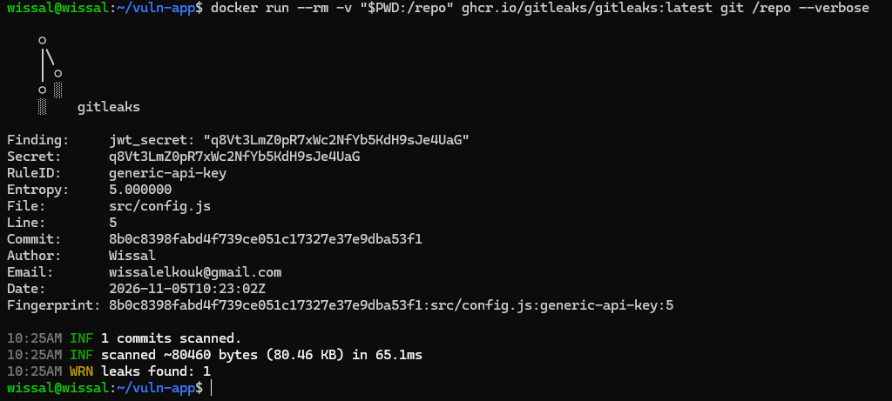
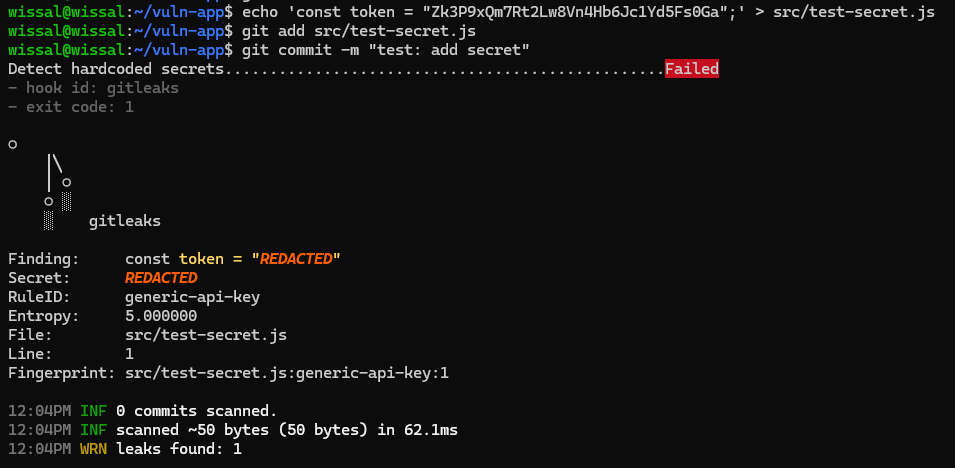
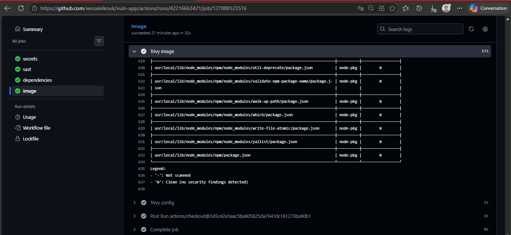
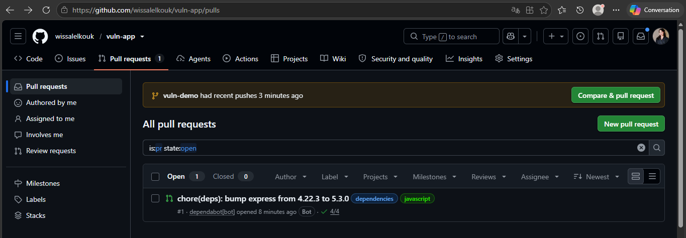
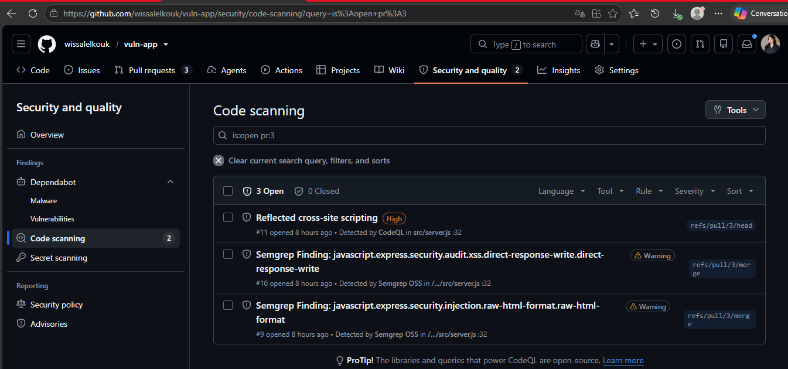
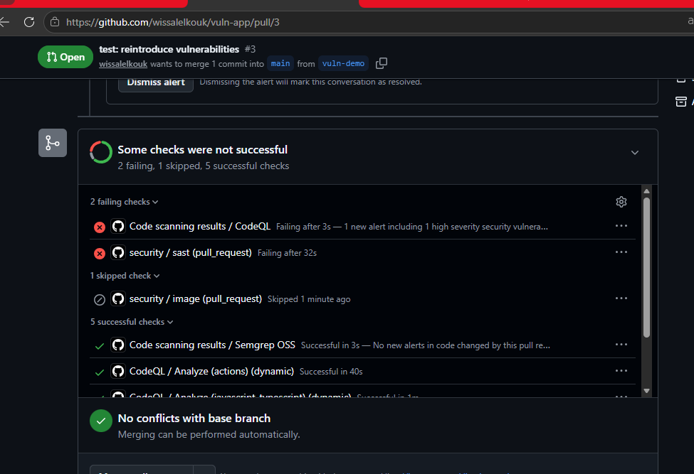
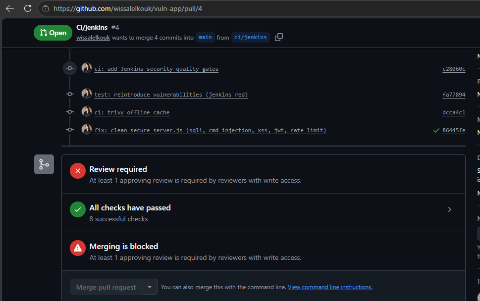
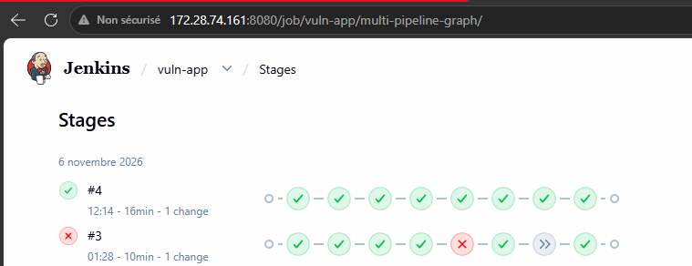
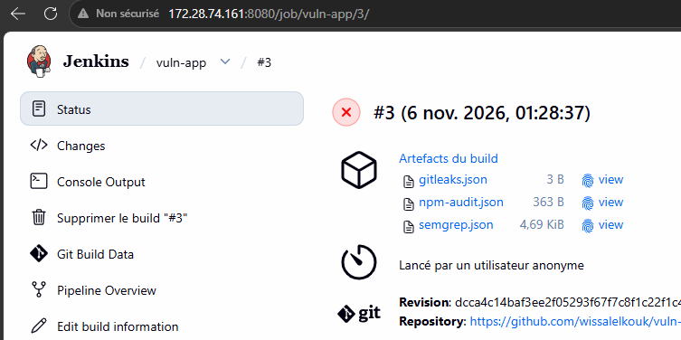
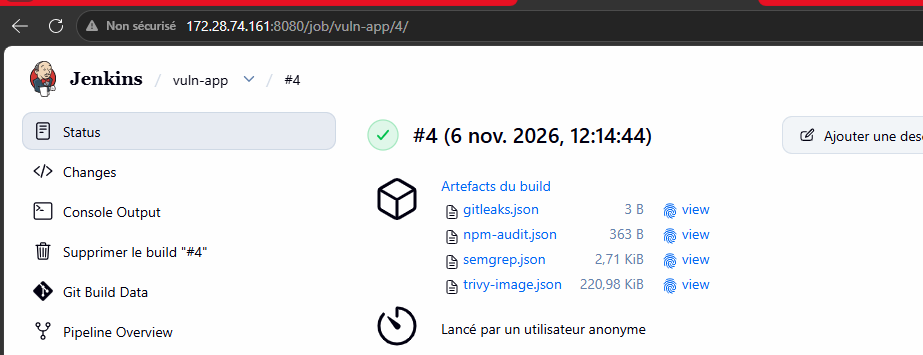

# TP9 : Pipeline as Code avec Jenkins

Pipeline Jenkins décrit dans le dépôt (`Jenkinsfile`) pour l'API Express `contact-api` du TP8 : stages, exécution parallèle, agent Docker, rapports JUnit, credentials, image Docker taguée avec le Git SHA, puis job Multibranch (branches et Pull Requests).

- **Dépôt** : `wissalelkouk/tp9-jenkins-pipeline` (code de l'API issu du TP8)
- **Dépôt utilisé par Jenkins pendant le TP** : `wissalelkouk/tp8-api-securisee` (les builds visibles sur les captures y ont été exécutés avant la copie du projet vers ce dépôt)
- **Image Docker Hub** : [`wissl/contact-api`](https://hub.docker.com/r/wissl/contact-api/tags)
- **Jenkins** : 2.580.1 (LTS), Docker sur la même VM (Ubuntu Server)
- **Jobs** : `contact-api` (Pipeline from SCM) et `contact-api-multibranch` (Multibranch)

---

## 1. Le pipeline

Le `Jenkinsfile` à la racine du dépôt définit les stages suivants :

| Stage | Rôle |
|---|---|
| Checkout | `checkout scm`, calcul de `SHORT_SHA = GIT_COMMIT.take(7)` |
| Install | `npm ci` dans un agent Docker `node:24-alpine` (`reuseNode true`) |
| Quality (parallèle) | **Lint** (`npm run lint`) et **Unit tests** (Vitest + rapport JUnit) |
| Build image | `docker build` avec le label `org.opencontainers.image.revision=${GIT_COMMIT}` et le tag `${IMAGE_NAME}:${SHORT_SHA}` |
| Push | `docker push`, **uniquement sur `main`**, avec le credential `dockerhub` |
| post | `junit` (always), `archiveArtifacts image.txt`, `cleanWs` (cleanup) |

Options : `disableConcurrentBuilds()`, `timestamps()`, `timeout(60 min)`, `buildDiscarder`.

Points importants :

- Le rapport JUnit est produit avec :
  `npm test -- --reporter=default --reporter=junit --outputFile.junit=reports/junit.xml`
  (le script `npm test` du projet exclut les tests d'intégration, qui exigent PostgreSQL).
- Le token Docker Hub est injecté avec `withCredentials` et utilisé via `--password-stdin`, dans des `sh` à **guillemets simples** : c'est le shell, pas Groovy, qui substitue les variables, donc le secret n'est jamais interpolé dans le script.
- La condition du stage Push couvre le job Multibranch (`branch 'main'`) et le job Pipeline simple (`GIT_BRANCH == 'origin/main'`).

---

## 2. Captures

### 2.1 Vue des stages : Lint et Unit tests en parallèle

Build #4 du job `contact-api` : tous les stages sont verts, **Lint** et **Unit tests** s'exécutent en parallèle dans *Quality*.


### 2.2 Rapport JUnit : un test en échec puis corrigé

Un test a été cassé volontairement (`GET /api/health`). Sur le build #5, **Unit tests** passe en rouge, **Build image** et **Push** sont sautés, le bloc `post` s'exécute et l'onglet *Tests* affiche le test en échec. Après correction (build #6), les 14 tests passent.


### 2.3 Credential masqué dans les logs

Le token Docker Hub apparaît sous la forme `****` dans la Console Output (`Masking supported pattern matches of $DH_TOKEN`), et le login réussit.


### 2.4 Image taguée avec le Git SHA

Le tag de l'image sur Docker Hub correspond au résultat de `git rev-parse --short HEAD` : ici `daada40` (build #6 du job `contact-api`). Sur `main`, le build final du Multibranch (#2, après le merge de la PR) a poussé le tag `827549a`, qui correspond aussi à `git rev-parse --short HEAD` sur `main`.


### 2.5 Multibranch Pipeline

Le job `contact-api-multibranch` découvre `main`, la branche `feature/rate-limit-config` et la Pull Request `PR-1`. Le stage **Push est sauté** sur la branche et sur la PR, et **exécuté sur `main`** après le merge (build #2, commit `827549a`, artefact `image.txt`).


---

## 3. Configuration Jenkins

**Plugins** : Pipeline, Git, GitHub Branch Source, Docker Pipeline, JUnit, Credentials Binding, Workspace Cleanup, Timestamper.

**Accès Docker** : `sudo usermod -aG docker jenkins && sudo systemctl restart jenkins`

**Credentials** :

| ID | Type | Usage |
|---|---|---|
| `dockerhub` | Username with password (access token Docker Hub) | Push de l'image |
| `github` | Username with password (fine-grained token, lecture seule) | Scan du dépôt par le Multibranch |

**Job Multibranch** : source GitHub, scan périodique toutes les 2 minutes (« Periodically if not otherwise run »), car la VM n'est pas joignable depuis Internet et ne peut pas recevoir de webhook. La stratégie *Discover branches* est réglée sur **All branches** pour afficher la branche en même temps que sa PR.

---

## 4. Problèmes rencontrés et solutions

| Problème | Cause | Solution |
|---|---|---|
| Jenkins ne démarrait pas (`start operation timed out`) | Démarrage lent sur une petite VM, timeout systemd par défaut | `TimeoutStartSec=600` dans un override systemd |
| Contrôleur « déconnecté », builds en attente | `/tmp` (tmpfs) sous le seuil de 1 Go : accumulation de fichiers `winstone*.jar` | Nettoyage de `/tmp`, `java.io.tmpdir` déplacé vers `/var/lib/jenkins/tmp` |
| Pipeline `ABORTED` pendant le push | `timeout(20 min)` dépassé | Timeout porté à 60 minutes |
| `docker push` coupé (`use of closed network connection`, timeout) | Perte de paquets sur le réseau de la VM (environ 15 %) et couche d'environ 57 Mo | Nouvel essai quand la perte est revenue à 0 % : toutes les couches ont été envoyées, puis le stage Push du pipeline est passé |
| Branche barrée dans le Multibranch | Comportement par défaut : exclure les branches déjà couvertes par une PR | *Discover branches → All branches* |

---

## 5. Commandes utiles

```bash
# Tests et lint en local
npm ci
npm run lint
npm test

# Rapport JUnit comme dans le pipeline
npm test -- --reporter=default --reporter=junit --outputFile.junit=reports/junit.xml

# Build et vérification du label de l'image
SHORT_SHA=$(git rev-parse --short=7 HEAD)
docker build --label org.opencontainers.image.revision="$(git rev-parse HEAD)" \
  -t wissl/contact-api:$SHORT_SHA .
docker inspect wissl/contact-api:$SHORT_SHA \
  --format '{{ index .Config.Labels "org.opencontainers.image.revision" }}'

# Comparer avec le tag affiché sur Docker Hub
git rev-parse --short HEAD
```

---

## 6. Livrables

| Fichier | Contenu |
|---|---|
| `Jenkinsfile` | Pipeline final |
| `captures/pipeline-stages.png` | Lint et Unit tests en parallèle |
| `captures/junit-report.png` | Test en échec puis corrigé |
| `captures/credentials-masked.png` | Token masqué (`****`) |
| `captures/dockerhub-sha-tag.png` | Tag `<sha>` sur Docker Hub et `git rev-parse --short HEAD` |
| `captures/multibranch.png` | Jobs `main`, `feature/…` et `PR-1` |

Le défi (Shared Library `buildAndPush` et plugin GitHub Checks) n'a pas été réalisé.

* * *

# TP10 : DevSecOps « Shift Left »

Analyse de l'application volontairement vulnérable `vuln-app` avec des outils open source (secrets, SAST, dépendances, images, configuration), branchés dans GitHub Actions et Jenkins avec des quality gates, puis correction des failles.

- **Dépôt TP10** : [`wissalelkouk/vuln-app`](https://github.com/wissalelkouk/vuln-app) (code corrigé, `security.yml`, `dependabot.yml`, `Jenkinsfile`)
- **Outils** : Gitleaks, pre-commit, Semgrep, npm audit, Trivy, Dependabot, CodeQL, GitHub Actions, Jenkins
- **Le Jenkinsfile du TP9 n'étant pas dans `vuln-app`**, un Jenkinsfile dédié a été créé pour le TP10 (job `vuln-app`, branche `ci/jenkins`).

## 1. Carte des scanners

| Famille | Question posée | Outils utilisés |
|---------|----------------|-----------------|
| Secrets | Un mot de passe ou un token est-il dans Git ? | Gitleaks, push protection GitHub |
| SAST | Mon code contient-il des motifs dangereux ? | Semgrep, CodeQL |
| SCA | Mes dépendances ont-elles des CVE connues ? | npm audit, Trivy fs, Dependabot |
| Image | Les paquets de l'image ont-ils des CVE ? | Trivy image |
| Config | Le Dockerfile est-il mal configuré ? | Trivy config |

## 2. Partie 1 : Secrets (Gitleaks)

Gitleaks a détecté **1 secret sur 3** : règle `generic-api-key`, `src/config.js` ligne 5 (`jwt_secret`), commit `8b0c839`. `payment_api_key` et `db_password` n'ont pas été détectés : un scanner ne voit pas tout, les trois valeurs ont donc été retirées.

Les secrets sont passés dans des variables d'environnement (`process.env`), avec `.env.example` versionné et `.env` ignoré. Gitleaks détecte toujours le secret **dans l'historique** : supprimer la ligne ne suffit jamais. Pour un vrai secret : le **révoquer** (il est compromis), puis éventuellement réécrire l'historique (`git filter-repo`). Pour le lab, l'historique a été recréé, et Gitleaks répond `no leaks found`.

[](captures/tp10-gitleaks.png)

## 3. Partie 2 : Hook pre-commit

Le hook Gitleaks refuse un commit contenant `const token = "…"` (`generic-api-key`, `src/test-secret.js:1`, exit code 1).

[](captures/tp10-pre-commit-blocked.png)

## 4. Partie 3 : SAST (Semgrep)

Premier scan : **7 résultats bloquants**. Après correction : **0 résultat, code retour 0**.

| Règle | Fichier:ligne | Vrai positif ? | Correction |
|-------|---------------|----------------|------------|
| `raw-html-format` | `server.js:32` | Oui | `res.json` |
| `direct-response-write` | `server.js:32` | Oui (même faille) | `res.json` |
| `missing-user` | `Dockerfile:8` | Oui | `USER node` |
| `github-actions-mutable-action-tag` (×4) | `security.yml:18, 26, 33, 40` | Oui | Actions épinglées par SHA complet |
| *(non détecté)* injection SQL | `server.js:21` | Oui | requête paramétrée `?` |
| *(non détecté)* injection de commande | `server.js:27` | Oui | `execFile` + validation de `host` |
| *(non détecté)* JWT sans expiration | `server.js:43` | Oui | `expiresIn: "1h"` |

Semgrep n'a pas signalé l'injection SQL, l'injection de commande ni le JWT : ces failles ont été corrigées à la main, ce qui montre l'intérêt de combiner plusieurs outils.

[](captures/tp10-semgrep-before-after.png)

## 5. Partie 4 : Dépendances, images et configuration

| Contrôle | Avant | Après |
|----------|-------|-------|
| `npm audit` | 16 (1 critical, 10 high, 5 low) | **0** |
| Trivy fs (dépendances) | nombreuses CVE HIGH/CRITICAL (`tar`…) | **0** |
| Trivy config | `DS-0031` **CRITICAL** (`ENV DB_PASSWORD=…`) | `DS-0026` LOW, corrigé par un `HEALTHCHECK` |
| Trivy image (GitHub Actions) | Debian 10 : 16 + 2 CRITICAL | Alpine 3.24 (`node:24-alpine`) : plus de CRITICAL corrigeable |

Mises à jour : `express`, `jsonwebtoken` 9, `lodash` 4.18, `sqlite3` 6. Dockerfile réécrit : `node:24-alpine`, multi-stage, `USER node`, aucun secret dans `ENV`.

Job `image` de GitHub Actions après correction (Alpine, tous les paquets à 0, job vert) :

[](captures/tp10-trivy-after.png)

**Dependency-Check** : la mise à jour de la base NVD a échoué (clé d'API refusée). Il a été remplacé par **Trivy fs**.

**Trivy image** : la base n'a pas pu être téléchargée de façon fiable depuis la VM (réseau très lent). Les scans d'image ont été exécutés dans GitHub Actions et Jenkins, la base ayant ensuite été mise en cache localement pour `fs` et `config`.

## 6. Partie 5 : GitHub

**Dependabot** : PR ouvertes automatiquement (`express` 4.22.3 → 5.3.0, `upload-sarif`). Le passage à Express 5 est un changement majeur : la PR n'a pas été fusionnée.

[](captures/tp10-dependabot-pr.png)

**CodeQL vs Semgrep** (PR #3 qui réintroduit les failles) :

| Faille | Semgrep | CodeQL |
|--------|---------|--------|
| Injection SQL | Non détectée | Non détectée |
| Injection de commande | Non détectée | Non détectée |
| XSS | Oui (2 règles) | Oui (High) |
| Rate limiting | Non | Oui (High, sur `main`) |
| Permissions du workflow | Non | Oui (Medium, sur `main`) |

[](captures/tp10-codeql-alerts.png)

**Workflow `security.yml`** : `permissions: contents: read` au niveau du workflow, `security-events: write` uniquement dans le job `sast` (export SARIF), Gitleaks, Semgrep, `npm audit` et Trivy en conteneurs, Actions tierces épinglées par SHA.

Pourquoi épingler par SHA ? Un tag (`v4`) peut être déplacé vers du code malveillant si le dépôt de l'Action est compromis. Un SHA de commit est immuable, et Dependabot (`github-actions`) propose ensuite les mises à jour.

**Ruleset `protect-main`** : PR obligatoire, 1 approbation, checks `secrets`, `sast`, `dependencies`, `image` obligatoires, force push bloqué. La PR #3 (faille réintroduite) est bloquée : `sast` et CodeQL sont en échec, `image` est ignoré.

[](captures/tp10-pr-blocked.png)

La PR #4 (correctif) passe tous les checks mais reste bloquée tant qu'un relecteur n'approuve pas. Seul développeur, j'ai ajouté un bypass temporaire pour la fusionner, puis je l'ai retiré.

[](captures/tp10-pr4-review-required.png)

## 7. Partie 6 : Quality gates dans Jenkins

Le `Jenkinsfile` exécute `Checkout`, `Build`, puis un stage **Security** avec Gitleaks, Semgrep et `npm audit` **en parallèle**, puis **Image scan** (Trivy `--exit-code 1 --severity CRITICAL`). Les rapports sont archivés (`archiveArtifacts 'reports/**'`).

- **Build #3 : rouge.** Semgrep a détecté la faille (XSS), `Image scan` est ignoré et aucun rapport Trivy n'est produit.
- **Build #4 : vert.** `server.js` corrigé, image scannée sur Alpine, 4 rapports archivés.

[](captures/tp10-jenkins-stages.png)

| Build #3 (rouge) | Build #4 (vert) |
|------------------|-----------------|
| [](captures/tp10-jenkins-build3-artifacts.png) | [](captures/tp10-jenkins-build4-artifacts.png) |

## 8. Défi

- **Règle Semgrep personnalisée** (`.semgrep/no-log-body.yml`) interdisant `console.log(req.body)`, ajoutée à `security.yml` et au `Jenkinsfile`. Test : `Findings: 1 (1 blocking)`.
- **`.trivyignore`** avec une date d'expiration (`exp:`). L'identifiant est fictif (aucune CVE à ignorer sur l'image finale) : il illustre le format.
- **Ignorer ou accepter un risque ?** *Ignorer* masque un résultat sans laisser de trace. *Accepter un risque* est une décision documentée : justification, responsable, date d'expiration et revue périodique. À l'échéance, le résultat réapparaît.

## 9. Problèmes rencontrés

| Problème | Cause | Solution |
|----------|-------|----------|
| `push` refusé (`workflow` scope) | Token sans le droit `workflow` | Nouveau token avec `repo` et `workflow` |
| Hook refusé (`configuration is unstaged`) | `pre-commit autoupdate` avait modifié la config | `git add .pre-commit-config.yaml` |
| Dependency-Check en échec | Clé d'API NVD refusée | Remplacé par Trivy fs |
| Trivy : `context deadline exceeded` | Réseau lent vers les registres de la base | Scans dans GitHub Actions et Jenkins, base mise en cache |
| `server.js` cassé (doublon `rateLimit`) | Corrections par `sed` appliquées deux fois | Fichier réécrit proprement, fusionné via PR |

## 10. Livrables TP10

| Fichier | Contenu |
|---------|---------|
| `captures/tp10-gitleaks.png` | Secret détecté par Gitleaks |
| `captures/tp10-pre-commit-blocked.png` | Commit refusé par le hook |
| `captures/tp10-semgrep-before-after.png` | Semgrep : 7 résultats puis 0 |
| `captures/tp10-trivy-after.png` | Trivy image (Actions) : image Alpine propre |
| `captures/tp10-dependabot-pr.png` | PR Dependabot |
| `captures/tp10-codeql-alerts.png` | Alertes CodeQL et Semgrep sur la PR #3 |
| `captures/tp10-pr-blocked.png` | PR bloquée par les checks obligatoires |
| `captures/tp10-pr4-review-required.png` | PR #4 : checks verts, relecture requise |
| `captures/tp10-jenkins-stages.png` | Pipeline Jenkins rouge (#3) puis vert (#4) |
| `captures/tp10-jenkins-build3-artifacts.png`, `…build4-artifacts.png` | Rapports archivés |

Code corrigé, `.github/workflows/security.yml`, `.github/dependabot.yml`, `Jenkinsfile` : voir [`wissalelkouk/vuln-app`](https://github.com/wissalelkouk/vuln-app).
