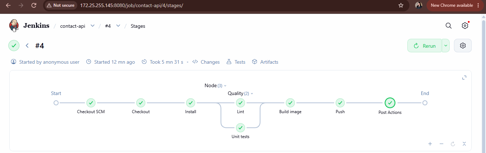
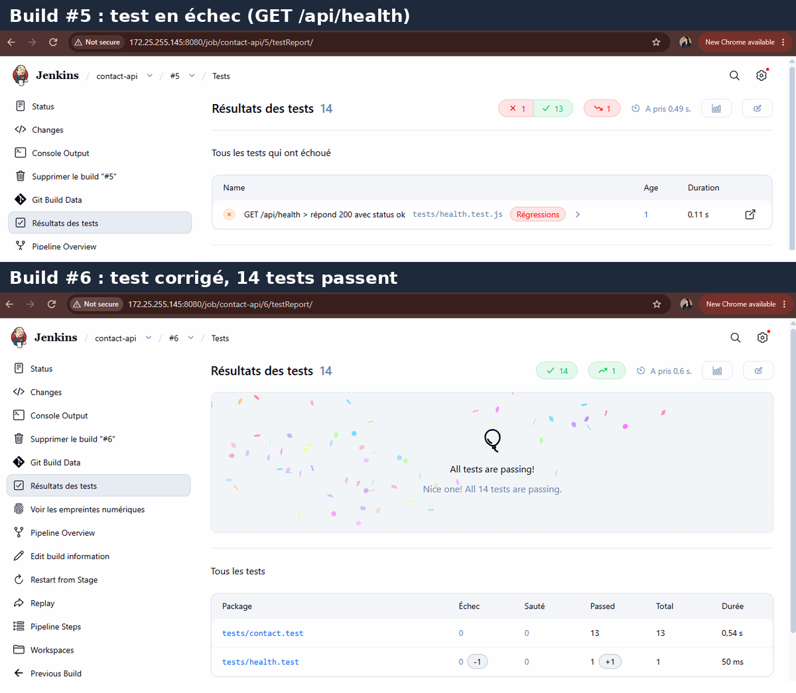
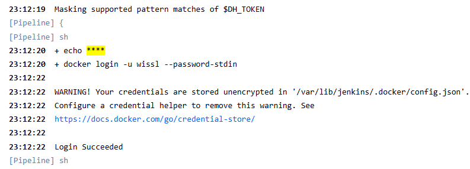
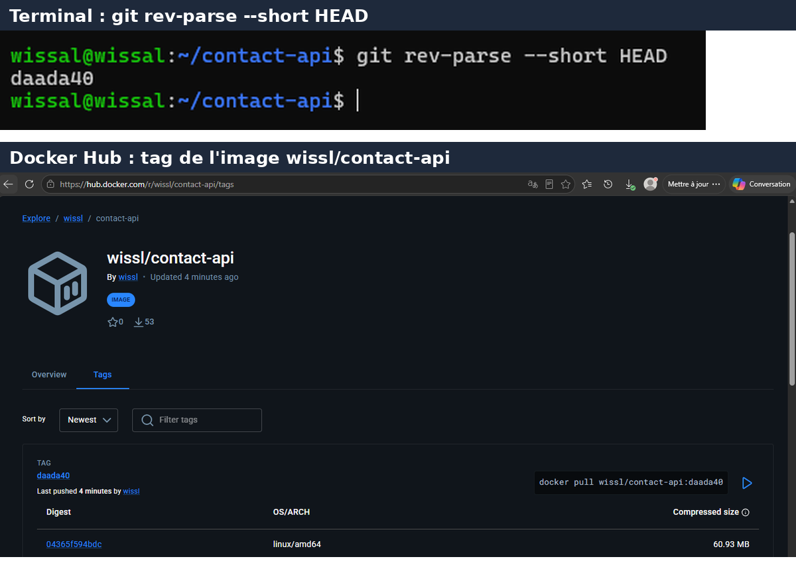
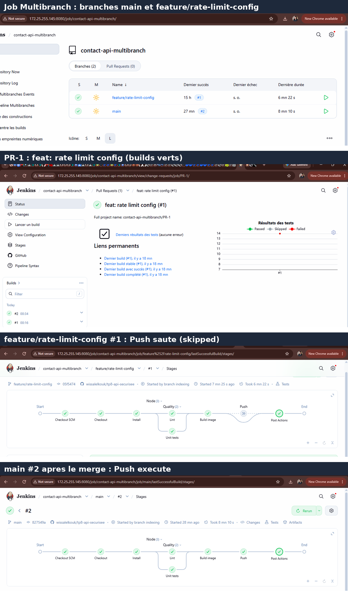

# TP9 : Pipeline as Code avec Jenkins

Pipeline Jenkins décrit dans le dépôt (`Jenkinsfile`) pour l'API Express `contact-api` du TP8 : stages, exécution parallèle, agent Docker, rapports JUnit, credentials, image Docker taguée avec le Git SHA, puis job Multibranch (branches et Pull Requests).

- **Dépôt** : `wissalelkouk/tp9-jenkins-pipeline` (code de l'API issu du TP8)
- **Dépôt utilisé par Jenkins pendant le TP** : `wissalelkouk/tp8-api-securisee` (les builds visibles sur les captures y ont été exécutés avant la copie du projet vers ce dépôt)
- **Image Docker Hub** : [`wissl/contact-api`](https://hub.docker.com/r/wissl/contact-api/tags)
- **Jenkins** : 2.580.1 (LTS), Docker sur la même VM (Ubuntu Server)
- **Jobs** : `contact-api` (Pipeline from SCM) et `contact-api-multibranch` (Multibranch)

---

## 1. Le pipeline

Le `Jenkinsfile` à la racine du dépôt définit les stages suivants :

| Stage | Rôle |
|---|---|
| Checkout | `checkout scm`, calcul de `SHORT_SHA = GIT_COMMIT.take(7)` |
| Install | `npm ci` dans un agent Docker `node:24-alpine` (`reuseNode true`) |
| Quality (parallèle) | **Lint** (`npm run lint`) et **Unit tests** (Vitest + rapport JUnit) |
| Build image | `docker build` avec le label `org.opencontainers.image.revision=${GIT_COMMIT}` et le tag `${IMAGE_NAME}:${SHORT_SHA}` |
| Push | `docker push`, **uniquement sur `main`**, avec le credential `dockerhub` |
| post | `junit` (always), `archiveArtifacts image.txt`, `cleanWs` (cleanup) |

Options : `disableConcurrentBuilds()`, `timestamps()`, `timeout(60 min)`, `buildDiscarder`.

Points importants :

- Le rapport JUnit est produit avec :
  `npm test -- --reporter=default --reporter=junit --outputFile.junit=reports/junit.xml`
  (le script `npm test` du projet exclut les tests d'intégration, qui exigent PostgreSQL).
- Le token Docker Hub est injecté avec `withCredentials` et utilisé via `--password-stdin`, dans des `sh` à **guillemets simples** : c'est le shell, pas Groovy, qui substitue les variables, donc le secret n'est jamais interpolé dans le script.
- La condition du stage Push couvre le job Multibranch (`branch 'main'`) et le job Pipeline simple (`GIT_BRANCH == 'origin/main'`).

---

## 2. Captures

### 2.1 Vue des stages : Lint et Unit tests en parallèle

Build #4 du job `contact-api` : tous les stages sont verts, **Lint** et **Unit tests** s'exécutent en parallèle dans *Quality*.



### 2.2 Rapport JUnit : un test en échec puis corrigé

Un test a été cassé volontairement (`GET /api/health`). Sur le build #5, **Unit tests** passe en rouge, **Build image** et **Push** sont sautés, le bloc `post` s'exécute et l'onglet *Tests* affiche le test en échec. Après correction (build #6), les 14 tests passent.



### 2.3 Credential masqué dans les logs

Le token Docker Hub apparaît sous la forme `****` dans la Console Output (`Masking supported pattern matches of $DH_TOKEN`), et le login réussit.



### 2.4 Image taguée avec le Git SHA

Le tag de l'image sur Docker Hub correspond au résultat de `git rev-parse --short HEAD` : ici `daada40` (build #6 du job `contact-api`). Sur `main`, le build final du Multibranch (#2, après le merge de la PR) a poussé le tag `827549a`, qui correspond aussi à `git rev-parse --short HEAD` sur `main`.



### 2.5 Multibranch Pipeline

Le job `contact-api-multibranch` découvre `main`, la branche `feature/rate-limit-config` et la Pull Request `PR-1`. Le stage **Push est sauté** sur la branche et sur la PR, et **exécuté sur `main`** après le merge (build #2, commit `827549a`, artefact `image.txt`).



---

## 3. Configuration Jenkins

**Plugins** : Pipeline, Git, GitHub Branch Source, Docker Pipeline, JUnit, Credentials Binding, Workspace Cleanup, Timestamper.

**Accès Docker** : `sudo usermod -aG docker jenkins && sudo systemctl restart jenkins`

**Credentials** :

| ID | Type | Usage |
|---|---|---|
| `dockerhub` | Username with password (access token Docker Hub) | Push de l'image |
| `github` | Username with password (fine-grained token, lecture seule) | Scan du dépôt par le Multibranch |

**Job Multibranch** : source GitHub, scan périodique toutes les 2 minutes (« Periodically if not otherwise run »), car la VM n'est pas joignable depuis Internet et ne peut pas recevoir de webhook. La stratégie *Discover branches* est réglée sur **All branches** pour afficher la branche en même temps que sa PR.

---

## 4. Problèmes rencontrés et solutions

| Problème | Cause | Solution |
|---|---|---|
| Jenkins ne démarrait pas (`start operation timed out`) | Démarrage lent sur une petite VM, timeout systemd par défaut | `TimeoutStartSec=600` dans un override systemd |
| Contrôleur « déconnecté », builds en attente | `/tmp` (tmpfs) sous le seuil de 1 Go : accumulation de fichiers `winstone*.jar` | Nettoyage de `/tmp`, `java.io.tmpdir` déplacé vers `/var/lib/jenkins/tmp` |
| Pipeline `ABORTED` pendant le push | `timeout(20 min)` dépassé | Timeout porté à 60 minutes |
| `docker push` coupé (`use of closed network connection`, timeout) | Perte de paquets sur le réseau de la VM (environ 15 %) et couche d'environ 57 Mo | Nouvel essai quand la perte est revenue à 0 % : toutes les couches ont été envoyées, puis le stage Push du pipeline est passé |
| Branche barrée dans le Multibranch | Comportement par défaut : exclure les branches déjà couvertes par une PR | *Discover branches → All branches* |

---

## 5. Commandes utiles

```bash
# Tests et lint en local
npm ci
npm run lint
npm test

# Rapport JUnit comme dans le pipeline
npm test -- --reporter=default --reporter=junit --outputFile.junit=reports/junit.xml

# Build et vérification du label de l'image
SHORT_SHA=$(git rev-parse --short=7 HEAD)
docker build --label org.opencontainers.image.revision="$(git rev-parse HEAD)" \
  -t wissl/contact-api:$SHORT_SHA .
docker inspect wissl/contact-api:$SHORT_SHA \
  --format '{{ index .Config.Labels "org.opencontainers.image.revision" }}'

# Comparer avec le tag affiché sur Docker Hub
git rev-parse --short HEAD
```

---

## 6. Livrables

| Fichier | Contenu |
|---|---|
| `Jenkinsfile` | Pipeline final |
| `captures/pipeline-stages.png` | Lint et Unit tests en parallèle |
| `captures/junit-report.png` | Test en échec puis corrigé |
| `captures/credentials-masked.png` | Token masqué (`****`) |
| `captures/dockerhub-sha-tag.png` | Tag `<sha>` sur Docker Hub et `git rev-parse --short HEAD` |
| `captures/multibranch.png` | Jobs `main`, `feature/…` et `PR-1` |

Le défi (Shared Library `buildAndPush` et plugin GitHub Checks) n'a pas été réalisé.
